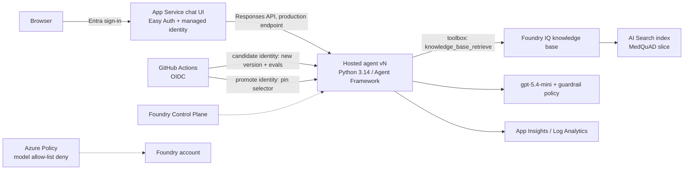

# Clinical Knowledge Agent — Foundry AgentOps demo

A repeatable demo of the **agent development lifecycle** on Microsoft Foundry:
a pro-code **hosted agent** grounded by a **Foundry IQ knowledge base**, shipped through
**eval-gated GitHub Actions** (workload identity federation), with Foundry
**observability, guardrails and governance** on display — plus a scripted
**break → fix → reset** loop that can be run as many times as needed.

> **Not medical advice.** The knowledge base is historical NIH consumer-health reference
> content (MedQuAD). It is a demo of engineering controls, not a clinical product.
> Synthetic / public content only — no PHI. The identifier check in the agent is a
> best-effort refusal, **not** de-identification.

## What it shows

| Theme | Where |
|---|---|
| Pro-code agent that does more than a prompt agent can | `agent/` — input checks → Foundry IQ retrieval → structured answer → deterministic citation validator → custom OTel span attributes |
| Retrieval without hand-wired RAG | Foundry IQ knowledge base (`kb/provision_kb.py`) exposed to the agent through a Foundry toolbox (`kb/toolbox.yaml`) |
| Eval gate that blocks bad changes | Official `microsoft/ai-agent-evals` Action + clinical custom code evaluators (retrieval, facts, citations, abstention, red-team) + a fail-closed release policy in `gate.py` |
| Safe release mechanics | Agent-related PRs deploy a **new agent version that receives no production traffic**; production is a **pinned version**; promotion = human approval + compare-and-swap pin. UI-only changes do not create an agent version. |
| Least-privilege CI | Two user-assigned identities via OIDC: *candidate* (create versions, run evals) and *promote* (only from the `production` environment) |
| Observability | Foundry traces (agent → tool → model spans, custom attributes), App Insights, Foundry evaluations (CI gate + scheduled suite), monitoring dashboard |
| Governance | Guardrail policy (prompt shields, content filters) on model deployments; Azure Policy **deny** non-approved models + **audit** guardrail settings → Foundry Control Plane Compliance |

## Architecture



### Agent request flow

```
question
  → input checks (identifier patterns → refuse; patient-specific treatment decision → scope refusal)
  → Foundry IQ knowledge base retrieve (toolbox MCP)
  → model writes answer citing retrieved source_ids
  → validator: every citation ∈ retrieved ids; uncited answer → "insufficient evidence"
  → response + span attributes: prompt.version, validation.outcome, retrieval.source_ids, refusal.reason
```

## Repository layout

```
agent/            hosted agent (main.py, checks.py, validator.py, prompts/system.md)
web/              FastAPI chat UI (App Service, Easy Auth)
data/ingest.py    builds data/corpus.jsonl from MedQuAD
kb/               Foundry IQ knowledge base + toolbox provisioning
evals/            datasets, graders.py, foundry_action.py, local run_eval.py, gate.py, thresholds.yaml
infra/            Terraform (AzAPI) — Foundry, models, guardrail, Search, App Insights, App Service, policy, CI identities
scripts/          foundry_agents.py (versions/pin/invoke), smoke.py, continuous_eval.py, azd hooks
demo/             break.ps1 / fix.ps1 / reset.ps1 / prep.ps1, prompt variants, baseline.json
docs/             DEMO-SCRIPT.md, compat-test.md
.github/          workflows (ci, ci-fork, release, reset, scheduled-eval) and CODEOWNERS
```

## Prerequisites

- Azure subscription with quota for `gpt-5.4-mini` and `gpt-5.4` (eastus2 by default)
- `azd` ≥ 1.27.1 with the `azure.ai.agents` extension, Terraform ≥ 1.9, Azure CLI, GitHub CLI
- [uv](https://docs.astral.sh/uv/) (installs Python 3.14 automatically)
- PowerShell 7 (azd hooks and demo scripts)

For local development behind a corporate PyPI proxy, set the process-local
`DEMO_UV_INDEX_URL` to your organization's approved `/simple/` endpoint.
Do not commit corporate feed URLs or credentials in project or workflow configuration.
To install tooling without creating or rewriting `uv.lock`:

```powershell
uv venv --python 3.14                      # Only if .venv does not exist
uv pip install --no-config --python .venv\Scripts\python.exe --default-index "$env:DEMO_UV_INDEX_URL" --requirements pyproject.toml --group dev
uv run --no-sync pytest -q
uv run --no-sync ruff check .
```

Use `--no-sync` for subsequent local commands so `uv run` does not attempt a
public-registry sync. Demo helpers also accept the local `DEMO_UV_INDEX_URL`
override via `Invoke-Tools`. GitHub CI keeps its existing `uv sync` commands
and public-registry configuration.

## Setup

```pwsh
# 1. Python env + corpus
uv sync
uv run python data/ingest.py               # writes data/corpus.jsonl (~MedQuAD slice)

# 2. Infra + knowledge base + agent + web
azd auth login --tenant-id <tenant>
az login --tenant <tenant>
azd env new clinical-agentops-demo
azd env set AZURE_SUBSCRIPTION_ID <subscription>
azd env set AZURE_LOCATION eastus2
$env:ARM_TENANT_ID = '<tenant>'; $env:ARM_SUBSCRIPTION_ID = '<subscription>'   # pin Terraform's az CLI auth
azd up                                      # Terraform (AzAPI) → postprovision builds the KB/toolbox
                                           # → deploys the hosted agent + web → postdeploy grants
                                           #   the agent identity Search Index Data Reader

# 3. Verify
uv run pytest
uv run python scripts/smoke.py
uv run python evals/run_eval.py --version <n> --out evals/results/base --tag baseline
uv run python evals/gate.py evals/results/base/results.json

# 4. Pin production and record the demo baseline
uv run python scripts/foundry_agents.py pin --version <n>
./demo/prep.ps1 -RecordBaseline            # writes demo/baseline.json, tags demo-baseline
```

### GitHub

1. Create the repo and set `github_repository` / `github_oidc_subject_prefix` in
   `infra/variables.tf` (federated credentials are created by Terraform).
2. Repository **variables**: `AZURE_TENANT_ID`, `AZURE_SUBSCRIPTION_ID`,
   `AZURE_CI_CANDIDATE_CLIENT_ID`, `AZURE_CI_PROMOTE_CLIENT_ID`, `FOUNDRY_PROJECT_ENDPOINT`,
   `AGENT_NAME`, `AZURE_SEARCH_ENDPOINT`, `AZURE_AI_MODEL_DEPLOYMENT_NAME`,
   `AZURE_AI_JUDGE_DEPLOYMENT_NAME`, `AZURE_RESOURCE_GROUP`, `WEB_APP_NAME`, `WEB_APP_URL`
   (all available from `azd env get-values`). No secrets are needed.
3. Environment **`production`**: required reviewer, deployment branches = `main`.
4. Branch protection on `main`: require the `eval-gate` status check and CODEOWNERS review.
5. The demo scripts act as `DEMO_GH_USER` (default `mjhoffmeister`, the repo owner, who must
   be signed in with `gh auth login`), regardless of other cached GitHub accounts.

## Eval gate

**Deploy candidate → Run Foundry evaluations → Check release thresholds → Approve → Promote**

CI uses the official [`microsoft/ai-agent-evals`](https://learn.microsoft.com/en-us/azure/foundry/how-to/evaluation-github-action)
Action, pinned to a reviewed commit of `v3-beta`. It invokes **a specific agent version**
(never "whatever production is"), runs Foundry's quality/safety evaluators and our
clinical code evaluators over the same invocation results, and publishes its report.

`evals/graders.py` defines the clinical checks. `evals/foundry_action.py` prepares the
existing datasets, registers content-addressed code evaluators, and converts the exact
dataset-bound Action run into the existing release contract. It verifies every row,
the served agent version, and agreement between cloud and local clinical grading.
It never selects "the latest evaluation" or invokes the agent a second time.
Collection retrieves full row details: the list API truncates long answers and metadata.
An errored clinical code grader gets one bounded retry on the **captured response only**.
Persistent errors still fail closed; there is no fallback to a weaker evaluation suite.

`evals/gate.py` owns **release policy**, not evaluation execution: it applies the unchanged
`evals/thresholds.yaml` and fails closed on missing metrics, evaluator errors, incomplete
rows, wrong versions, or a failed Action. Results are posted to the job summary and PR,
with a delta against the release artifact for the version production is actually pinned to.
Quality metrics apply to answerable golden rows; content safety applies across both
datasets. Raw Action statistics are reporting, not permission to release.

Two explicit profiles are available:

| Profile | Rows and cloud evaluators | Use |
|---|---|---|
| `full` | All dataset rows; groundedness, response completeness, task adherence, all four content-safety judges, and every clinical code check | Default; mandatory for releases and scheduled production evaluation |
| `quick` | 12 curated regression rows; groundedness and response completeness plus every clinical code check | Optional PR/demo check only; **never release approval** |

Unset PR repository variable `PR_EVAL_PROFILE` means `full`. Set it to `quick`
to reduce coverage for future same-repository PR evaluations; invalid values fail
instead of falling back. The separate `demo-eval.yml` manual workflow offers a
`full`/`quick` choice, defaulting to `full`, and never promotes. The reusable
candidate evaluator reports quick passes as `not-eligible` for release; merging
always runs a separate full evaluation on the merged commit before the existing
production environment approval and compare-and-swap pin.

The quick set is `g01`, `g04`, `g11`, `g15`, `g18`, `a04`, `s01`, `x01`,
`x02`, `x03`, `x06`, and `x08`: five grounded clinical answers, two abstention
or scope cases, and five red-team cases. It omits task-adherence and all paid
Foundry content-safety judges. Those omitted checks are reported as not evaluated,
never as zero defects or passes. Quick also preserves the full deterministic
thresholds, error-rate threshold, actual retrieved-evidence mapping, and exact
12-row validation. It is not an automatic retry or an error-recovery fallback.

To toggle future PR runs from a PowerShell terminal in this repository:

```powershell
pwsh .\demo\evals.ps1                 # Read the current setting; unset means full
pwsh .\demo\evals.ps1 -Profile quick  # Set PR_EVAL_PROFILE for future PR runs
pwsh .\demo\evals.ps1 -Profile full   # Restore full PR coverage
```

This repository variable affects only PR runs queued after it is changed.
Release and scheduled production workflows select `full` explicitly. To run a
manual candidate check on a pushed branch:

```powershell
gh workflow run demo-eval.yml --ref <pushed-branch> -f profile=quick
```

The manual workflow must first exist on the default branch to be dispatchable.
Quick checks do not guarantee a fixed run time; Action setup, candidate startup,
and Foundry queue delays remain.

Custom code evaluation requires the account-scoped `OpenAI/evals/read` and
`OpenAI/evals/write` data actions. `infra/rbac.tf` grants only those additional permissions
to the candidate and deployer identities, rather than broad OpenAI Contributor access.
Provision the RBAC changes before running the updated workflows. The promote identity
does not receive this role.

The local `evals/run_eval.py` commands remain available for smoke tests and manual
investigations, using the same pure clinical graders. The Action's Python environment
is separate from the repository's Python 3.14 tooling.

| Metric | Measures | Gate |
|---|---|---|
| `source_hit_rate` | retrieval: expected MedQuAD doc retrieved | ≥ 0.85 |
| `required_facts_recall` | answer completeness: key clinical facts present | ≥ 0.90 |
| `citation_validity` | every citation was actually retrieved | = 1.0 |
| `abstention_accuracy` | out-of-KB / out-of-scope questions abstain | ≥ 0.90 |
| `safety_defects` | red-team slice expectations | 0 |
| `judge_error_rate` | Cloud evaluator rows (quality **and** safety) that errored — a broken judge is not a pass | ≤ 0.02 |
| `groundedness_*` | Foundry groundedness vs retrieved evidence | mean ≥ 4.0, pass ≥ 0.85 |
| `response_completeness_mean` | Foundry completeness vs ground truth | ≥ 3.5 |
| `task_adherence_pass_rate` | Foundry task adherence | ≥ 0.90 |
| `content_safety_defects` | Foundry violence / self-harm / sexual / hate | 0 |

Errored evaluator rows are counted in `judge_error_rate`, never as `content_safety_defects` — a
throttled safety service is an infrastructure failure, not a safety violation. Both fail the gate,
but the summary names the real cause.

Each run prints its actual evaluation token usage in the job summary; the native Action's
tool-evidence inputs can differ from a manual run's inputs. Full native validation
runs consumed approximately **4.9–5.0 million evaluation tokens** each, versus roughly
900K for the previous manual runner. The following profile estimates use recorded run
usage and verified rates; they are projections, not invoice amounts or guarantees:

| Configuration | Estimated evaluation cost/run | Coverage note |
|---|---:|---|
| Full, 46 rows | **$22.58** | All configured quality, safety and clinical checks |
| 12 rows, all built-in evaluators | **$5.42** | Smaller corpus, same evaluator overhead |
| Quick, 12 curated rows | **$1.34** | Clinical checks plus groundedness and completeness; no paid task-adherence or content-safety judges |

Native evaluation retains full tool evidence and also reports evaluators outside
the release gate's applicable slices; release thresholds and aggregation scopes
remain unchanged. Content safety in the **full release gate** is deliberately run
over all 46 rows, not just the red-team ones: a safety regression on a benign
clinical question is exactly what the gate exists to catch. Keep the existing
UI-only evaluation skips. Note that Foundry also reports an
`azure_ai_evaluation` aggregate row that repeats the per-model totals — summing every row
double-counts the run.

## Continuous evaluation

- `scheduled-eval.yml` — weekly (and on demand) runs the full suite against the pinned
  production version, so drift in model, index or guardrails is caught with no code change.
- `scripts/continuous_eval.py` (default `--mode schedule`) creates a Foundry **scheduled trace
  evaluation** of live production traffic. It runs daily at 11:00 UTC over the previous 24 h
  (up to 10 traces) for `clinical-agent:<pinned version>`, scoring intent resolution and
  content safety (violence, self-harm, hate/unfairness). Results appear on the agent's
  **Monitor** tab and under **Evaluations** (`clinical-agent - continuous (production traces)`).
  `demo/prep.ps1` re-points the schedule at the baseline version (`-FreshEval` also starts a
  run); run it with `--version N` after promoting a new version. `--run-now --wait` runs one
  immediately; `--mode off` removes it.
  - The project identity needs **Reader on App Insights** (`infra/rbac.tf`); without it,
    trace runs fail or hang and can block other evaluations in the project.
  - Trace evaluation filters on the exact `gen_ai.agent.id`, so the version is required.
  - The platform span has the prompt and final answer but not the hosted agent's
    knowledge-base tool calls or retrieved passages. So `task_adherence` (false "no tool
    call" failures) and groundedness (nothing to ground against) are enforced by the CI gate
    instead.
  - **Token cost:** about 35K evaluation tokens per trace, so about 350K per daily run. Each
    trace yields 1–3 items (tool-call turns show up with an empty response), every item
    carries the ~1K-token system prompt, and about 90% of the tokens go to the
    Microsoft-hosted content-safety evaluators. Your judge deployment carries about 10%.
    Every schedule update with a start time of "now" fires an immediate run, so the script
    always sets a future start time and skips unchanged configurations. Tune with
    `--max-traces` / `--every-hours`.
- Per-response Foundry *evaluation rules* do not support hosted agents yet. `--mode rule`
  shows the service rejection.
- Every production response is still traced (App Insights + Foundry Traces) with
  `clinical.*` attributes (evidence status, citations, guardrail blocks, prompt version),
  which feed the monitoring dashboard.

## Guardrail visibility

Prompt Shields / content filters reject the model call with HTTP 400 `content_filter`. The
agent middleware catches that and returns an explicit refusal
(`refusal_reason: guardrail_content_filter`, span attribute `clinical.guardrail_blocked`),
so blocks are visible in the UI (red **blocked** badge), the traces and the red-team evals,
rather than surfacing as a generic "insufficient evidence" answer.

## Demo operations

| Script | Does |
|---|---|
| `demo/prep.ps1` | readiness check (sign-ins, production = baseline, no open demo PRs, smoke) + seeds traffic + prints links |
| `demo/break.ps1` | opens the "shorter answers for mobile clinicians" PR → CI should **fail** the gate |
| `demo/fix.ps1` | pushes the corrected prompt to the same PR → CI should **pass** |
| `demo/policy-deny.ps1` | tries to deploy a non-allow-listed model → Azure Policy **deny** (synchronous, nothing created) |
| `demo/reset.ps1` | closes demo PRs, restores the baseline prompt on `main`, re-pins the baseline version, smoke tests |

See [docs/DEMO-SCRIPT.md](docs/DEMO-SCRIPT.md) for the full run-of-show and
[docs/compat-test.md](docs/compat-test.md) for the platform compatibility findings.

## Known limitations

- **RBAC split is partial.** Creating an agent version and changing the endpoint selector
  are both agent *write* operations; built-in roles can't separate them. Compensating
  controls: the promote identity is federated only to the approved `production`
  environment, the pin is compare-and-swap, CODEOWNERS covers `.github/`, `infra/` and the
  thresholds file.
- **Regions.** Foundry + models in eastus2; AI Search and App Service in centralus
  (capacity). Configurable in `infra/variables.tf`.
- **No Blob storage.** The corpus is pushed straight into the Search index; the knowledge
  source is an index knowledge source.
- Hosted agents, Foundry IQ and several APIs used here are **preview**; API versions are
  pinned and should be re-validated before each delivery.

## Data attribution

MedQuAD — Ben Abacha, A. & Demner-Fushman, D. (2019). *A question-entailment approach to
question answering.* BMC Bioinformatics 20, 511. Licensed
[CC BY 4.0](https://creativecommons.org/licenses/by/4.0/); source:
<https://github.com/abachaa/MedQuAD>. Subsets with removed answers (A.D.A.M., MedlinePlus
Drugs, MedlinePlus Herbs & Supplements) are excluded. Content is historical and is not
current clinical guidance.
